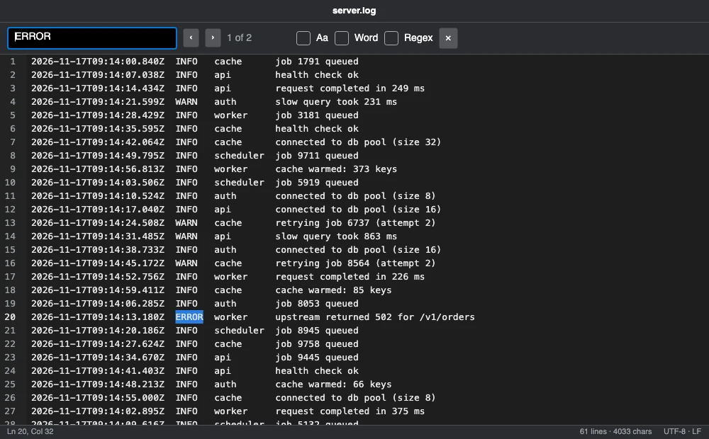

# Features

Plaintain opens any file it can decode, shows it in a monospace font with a line-number gutter, and writes it back byte for byte. It deliberately doesn't highlight syntax, fold JSON or show a CSV as a table: structured config is still text.

## Encodings

Plaintain works out a file's encoding when it opens it and shows it in the status bar. A byte-order mark is believed. Without one, the file is checked as UTF-8, not assumed to be.

A file that isn't valid UTF-8 is read as Latin-1, which maps every byte, and opens **read-only**: you get a message once, a dimmed gutter, and a note in the status bar. Saving waits until you confirm the encoding. To actually change it, use **File ▸ Convert Encoding…**, which offers the five encodings Plaintain can write and saves the file in the one you pick. Nothing ever converts a file without being asked.

## Line endings

LF and CRLF are kept exactly, and new lines use the ending the file already uses. A file that mixes the two shows `CRLF (mixed)` or `LF (mixed)` in the status bar. **Edit ▸ Normalise Line Endings…** shows both counts and rewrites the file to the one you choose, as one undoable edit. Opening a mixed file changes nothing.

## Saving and recovery

Saves are atomic: Plaintain writes a temporary file next to the original, then renames it into place. Auto-save is on by default for files that have a name and a known encoding.

Every 30 seconds, an edited document is also copied to a recovery snapshot. If Plaintain quits without saving, it offers the text back the next time it starts. You can change both intervals in **Preferences**.

## Files that change on disk

When another program changes the open file and you have no unsaved edits, Plaintain reloads it. If you have unsaved edits, it keeps them, says "changed on disk" in the status bar, and asks what to do the next time you save: **Reload**, **Save As…** or **Keep Mine**. Reload is one undoable step, so ⌘Z brings your version back.

A growing log is followed: if the caret is at the end of the file when new lines arrive, it moves to the new end, as `tail -f` does. Scroll up and the view stays where you put it.

## Find and Replace

⌘F opens the find strip over the text. It finds plain text or a regular expression, with options for case (**Aa**) and whole words (**Word**), and shows a live match count. It starts from the first match at or after the caret, and Enter steps through matches, wrapping both ways.

⌥⌘F adds a replace row. **Replace** changes the selected match and moves to the next one. **Replace All** changes every match as one undoable edit. In regex mode the replacement can use `$1` and `${name}` groups.

## Multiple selections

⌘D selects the word under the caret, then adds the next occurrence of it with each press. Typing, Backspace, Delete and Return then change every selection at once, as one undoable edit. Escape removes the extra selections.

While something is selected, other places it appears are tinted, so you can see where else it is without opening find.

## Moving and copying lines

⌥↑ and ⌥↓ move the selected lines up or down. ⇧⌥↑ and ⇧⌥↓ copy them above or below. Each line keeps its own line ending.

## Show Invisibles

⌥⌘I marks whitespace you can't otherwise see: a tab as `→`, a space at the end of a line as `·`, and a CRLF line ending as `¤`. LF endings get no mark, so in a mixed file the CRLFs stand out.

## Word wrap, line numbers and zoom

Word wrap is off by default, which keeps a log's columns lined up. ⌥⌘R turns it on, and long lines then fold between words. ⌥⌘L hides or shows the line numbers. ⌘+ and ⌘− zoom, and ⌥⌘0 resets the zoom. Plaintain remembers each of these.

## Themes

Plaintain follows the system's light or dark appearance unless you choose one in **Preferences**. You pick a colour theme for each appearance from nine built-in themes, or add your own as a JSON file. See [Colour themes](themes.md).

## Dictation

macOS dictation types your words as you speak them, not all at once when you stop.

## Large files

A 50 MB file opens and scrolls without stalling, because every row is the same height and Plaintain only draws the rows on screen.

## The `plaintain` command

`plaintain file` opens a file in the app, and `plaintain info file` prints its encoding, line endings and counts without opening it. See [Getting started](getting-started.md#the-plaintain-command).
